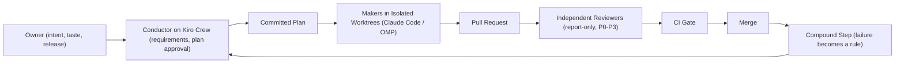

# Ryan Lee

**Building autonomous software factories with TypeScript, Effect, and Rust — orchestrated on [Kiro Crew](https://kiro.dev/docs/crew).**

  

  
  
  
  
  
  
  
  
  
  

---

## 🏭 The Software Factory

I design and run multi-agent software engineering pipelines at **[System F Software](https://github.com/systemfsoftware)**. Human attention stays focused on intent, taste, and release, while specialized coding agents handle planning, isolated implementation, adversarial review, and rule compounding.

---

## ⚙️ Running on Kiro Crew

The factory runs on **[Kiro Crew](https://kiro.dev/docs/crew)**, AWS's open-source personal agent platform, orchestrating **Claude Code** and **Oh My Pi (OMP)** coding agents as makers and reviewers:

- **Specialized Conductors:** Dedicated conductors per product area alongside isolated ledger and security conductors.
- **Editorial & Visual Loop:** A Gemini copy desk, a design critic, and a page judge reviewing copy and rendered interfaces before release.
- **Execution & Skill Density:** Isolated workers backed by ~68 skills on the main conductor.
- **Hard Guardrails & Recovery:** Gate hooks that refuse unsafe actions and auto-nudge patrol loops that keep stalled sessions moving.
- **Durable Memory & Deployment:** Lessons that turn corrections into permanent rules, all deployed reproducibly with Nix `home-manager` from a pinned Git ref.

---

## 📦 Built in the Open

Public libraries, developer tools, and conformance suites published under [`systemfsoftware`](https://github.com/systemfsoftware):

| Repository | Description | Stars |
| :--- | :--- | :---: |
| [`stryker-js-effect`](https://github.com/systemfsoftware/stryker-js-effect) | Effect 4 mutation testing with in-memory V8 instrumentation, Vitest runner sandboxes, and NDJSON event streams. |  |
| [`api-extractor-effect`](https://github.com/systemfsoftware/api-extractor-effect) | Effect-native API Extractor producing byte-identical `*.api.md` reports against `@microsoft/api-extractor`. |  |
| [`are-the-types-wrong-effect`](https://github.com/systemfsoftware/are-the-types-wrong-effect) | Effect-native package export and TypeScript module resolution analyzer. |  |
| [`effect-e2e`](https://github.com/systemfsoftware/effect-e2e) | Effect-native end-to-end testing across core, web engine, CLI, and engine conformance suites. |  |
| [`effect-daemon`](https://github.com/systemfsoftware/effect-daemon) | Daemon specification and conformance suite supporting process, socket, and cluster media. |  |
| [`effect-microvm`](https://github.com/systemfsoftware/effect-microvm) | Microsandbox binding and daemon microVM medium for isolated execution. |  |
| [`effect-readiness`](https://github.com/systemfsoftware/effect-readiness) | Readiness cells and their deterministic conformance surface. |  |
| [`gritlint`](https://github.com/systemfsoftware/gritlint) | Conventions gate implemented as a Rust CLI on the GritQL engine, packaged as a Nix flake. |  |
| [`comment-checker`](https://github.com/systemfsoftware/comment-checker) | Offline Claude Code hook flagging unnecessary comments and AI slop via Tree-sitter across 37 languages. |  |
| [`omp-claude-compat`](https://github.com/systemfsoftware/omp-claude-compat) | Claude Code settings hooks and `CLAUDE.md` `@`-references running natively in Oh My Pi agents. |  |
| [`constitution`](https://github.com/systemfsoftware/constitution) | Engineering constitution (functional core / imperative shell, types-first, mutation-tested) vendored across repos and enforced by AI coding agents. |  |
| [`hex-schema`](https://github.com/systemfsoftware/hex-schema) | Hex-encoded byte schemas built for Effect Schema. |  |
| [`rx-effect`](https://github.com/systemfsoftware/rx-effect) | RxJS `Observable` to typed Effect `Stream` bridge with backpressure and interruption semantics. |  |
| [`effect-memfs`](https://github.com/systemfsoftware/effect-memfs) | In-memory filesystem implementation for Effect (fork of [`nounder/effect-memfs`](https://github.com/nounder/effect-memfs)). |  |
| [`discern`](https://github.com/systemfsoftware/discern) | Static analysis and code inspection tooling (fork of [`doeixd/discern`](https://github.com/doeixd/discern)). |  |
| [`effect-endgame-starter-kit`](https://github.com/systemfsoftware/effect-endgame-starter-kit) | Opinionated project template pre-wired with Effect, strict typing, mutation testing, and agent guardrails. |  |

---

## 🧠 How I Build

- **Plan before code:** An outer-loop conductor owns requirements and approves a committed plan in the repository before a single line of implementation is written.
- **Inspect the state, never the transcript:** Automated checks read only the produced repository state and artifacts, never how an agent arrived there.
- **Reviewers report, CI decides:** Independent reviewers audit the exact PR head in report-only mode (`P0`–`P3`), while deterministic CI remains the sole merge gate.
- **Taste belongs in review:** Aesthetic, architectural, and API design calls go to human or critic review, never to brittle lint rules.
- **State lives in Git and the issue tracker:** Ephemeral chat context is disposable; durable memory lives in committed plans, rules, and issues.
- **Done means verified in production:** A task is complete only after it is deployed and checked against the real system.

---

## 📰 Newsletter

Get the long-horizon prompt to build your own software factory at **[systemfsoftware.com](https://systemfsoftware.com)**.

---

## 🎮 Fun Fact

Ranked **Top 50 Grandmaster** in *StarCraft II* during the *Heart of the Swarm* era.

---

## 📡 Connect

  
  
  
  

